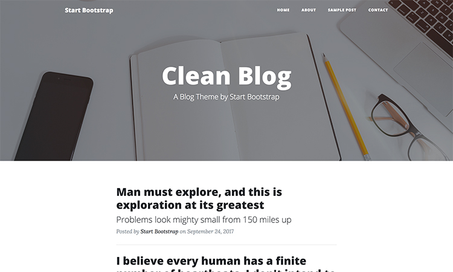

# Clean Blog for Textpattern

Clean Blog is a carefully styled Bootstrap blog theme that is perfect for personal or company blogs. This theme features five pages: a blog index, a single article page, an archive/search page, a contact page and an error page.

[Live Demo →](http://lab.brahm.com.br/cleanblogtxp/)

**Theme version 3.0** — Bootstrap 5 and Textpattern 4.9. See [Upgrading from 2.x](#upgrading-from-2x) if you are already running an older release of this theme.

## Features:
-   Built to support the  **latest, stable releases**  of all major browsers and platforms.
-   Fully responsive template created with Bootstrap 5.
-   Modern design with a subtle splash of color, easy to customize by editing a single stylesheet.
-   Distraction free blog text optimized for legibility with a menu bar interface that conveniently appears when you scroll up!
-   Five pages including a blog index, a single article page, an archive/search page, a contact page and an error page.
-   Contact form powered by com_connect.
-   Footer with social links and copyright information.
-   No jQuery: Bootstrap 5 dropped the dependency and the theme script is plain JavaScript.

## Required Environment / Minimum Setup

-   **Textpattern 4.9** (developed against 4.9.1). The theme uses `<txp:items_count />`, introduced in 4.9.0, which replaces the deprecated `<txp:search_result_count />`.
-   **Bootstrap 5.3** — version 5.3.8 ships in `assets/vendor/bootstrap`. The templates use the `data-bs-*` attributes and the `--bs-*` custom properties introduced in Bootstrap 5, so they will not work against Bootstrap 4.
-   **com_connect 4.9.0 or newer** (bundled). See the note under Plugins.

## Plugins:

-   **[com_connect](https://github.com/textpattern/com_connect)** v4.9.0 — form mailer plugin for Textpattern CMS. This release is **required** on Textpattern 4.9: earlier versions call `encode_mailheader()` and `strip_rn()`, which core removed in 4.9, so submitting the contact form raises a fatal error. If you are upgrading, uninstall the old plugin from the admin panel before installing this one — both register under the name `com_connect`.
-   **[cbs_gravatar](http://textpattern.org/plugins/628/cbs_gravatar)** v0.3 — displays [gravatars](http://www.gravatar.com/) in comment forms. It works on Textpattern 4.9, but it is unmaintained and hard-codes `http://` avatar URLs, so the images are blocked as mixed content on an HTTPS site.

## Installation

### Theme

-	Upload the **cleanblogtxp** folder to the themes folder in the root of your Textpattern install.
-	In Textpattern, go to Presentation/Themes and on the **Import from disk** drop-down list select **Clean Blog for Textpattern**, then click on Upload.

The import creates all the pages, forms and the stylesheet for you. You only have to assign the pages to sections yourself — see Sections below.

### Assets

-	Upload the **assets** folder to the root of your Textpattern install.

This folder holds the stylesheet, the script, the images and the vendored copies of Bootstrap and Font Awesome. The theme references everything in it through `<txp:site_url />assets/…`, so it has to sit at the web root, not inside the themes folder.

### Plugins

Install and activate with level 5 both the com_connect and cbs_gravatar plugins.

### Custom Fields

Go to Admin/Preferences/Advanced/Custom Fields and create two of them:

| Field | Used for |
|-------|----------|
| **Article BG** | image used as the header background of a post |
| **Post_Description** | meta description of a single article |

### Sections

Configure the Sections this way:

| Name     | Title    | Page    | Style   | Appears | Syndicate | Search |
|----------|----------|---------|---------|---------|-----------|--------|
| default  | default  | default | default | yes     | yes       | yes    |
| contact  | Contact  | contact | default | no      | no        | yes    |
| articles | Articles | default | default | yes     | yes       | yes    |
| archive  | Archive  | archive | default | no      | no        | no     |
| about    | About    | single  | default | no      | no        | yes    |

The archive page lists articles from the **articles** section specifically, so posts you want listed there must live in it.

## Navigation Menu

The navigation menu has the section list hard coded, so when you create new pages or sections don't forget to update the form  **clean_nav**.

## How to Make a New Single Page

1.  Create a new  **section**  and use the  **single**  page as template.
2.  Create a new  **post**  and use the  **section**  you just created.
3.  Fill in the  **title**, it will be displayed on the article body of this page, and  **summary**  field will be displayed in the page header.
4.  In  **Excerpt markup**  select  **Leave text untouched**.
5.  Each page has a beautiful background header, to be simple to change for your own images, the theme will look for a file with a pattern  **section_name-bg.jpg**.
6.  Upload an image file to the  **assets/img**  folder using this  **section_name-bg.jpg**  pattern name, it will be the header background of this page.
7.  Publish!

## How to Make a New Post

1.  Create a new  **post**  and use the section  **articles**.
2.  Select the categories.
3.  Fill in the  **title**  and  **summary**  fields. Its contents will be displayed in the page header.
4.  In  **Excerpt markup**  select  **Leave text untouched**.
5.  Fill in the custom  **Article BG**  field with image you want to be displayed as header background.
6.  Publish!

## Customizing

All the styling lives in `assets/css/clean-blog.css`. There is no build step and no preprocessor: the file is plain CSS, edited by hand.

The pages load the minified `assets/css/clean-blog.min.css`, and the same goes for `assets/js/clean-blog.min.js`. **Editing only the unminified file has no visible effect** — update both, or point `clean_head`/`clean_js` at the unminified versions while you work.

Colors follow Bootstrap 5 conventions. The accent color `#0085A1` is set on `.btn-primary` through the `--bs-btn-*` custom properties, which is why no `!important` is needed to override Bootstrap.

## Upgrading from 2.x

Version 3.0 is a breaking change. Before importing:

-   Move to **Textpattern 4.9** first. The theme no longer runs on 4.7/4.8.
-   Replace com_connect with **v4.9.0**, uninstalling the old one first.
-   Replace `assets/vendor/bootstrap` with **Bootstrap 5.3**. Any custom markup you added still using Bootstrap 4 classes needs migrating too — `data-toggle` → `data-bs-toggle`, `ml-*`/`mr-*` → `ms-*`/`me-*`, `float-left`/`float-right` → `float-start`/`float-end`, and `.form-group` is gone.
-   Re-importing the theme **overwrites the pages and forms** already in the database, so back up any changes you made through the admin panel.

## Development Information

This theme wouldn't have been possible without the following open source resources:

-   Textpattern ([https://textpattern.com/](https://textpattern.com/))
-   Bootstrap ([https://getbootstrap.com/](https://getbootstrap.com/))
-   Gravatar plugin made by Christophe Beyls ([http://textpattern.org/plugins/628/cbs_gravatar](http://textpattern.org/plugins/628/cbs_gravatar))
-   Connect plugin (zem, Mary, Stuart, wet, Tranquillo, aslsw66, jdykast, Ruud, Bloke, and now supported and tested to destruction by the Textpattern community) — [com_connect](https://github.com/textpattern/com_connect)
-   Font Awesome iconic font set ([https://fontawesome.com/](https://fontawesome.com/))

And a special thank you to Michael K Pate ([http://michaelkpate.com/](http://michaelkpate.com/)) for having pointed out many bugs.

## Copyright

[Clean Blog](https://startbootstrap.com/template-overviews/clean-blog/) is a theme that belongs to the [Start Bootstrap](https://startbootstrap.com/), a project created and maintained by [David Miller](http://davidmiller.io/) at [Blackrock Digital](http://blackrockdigital.io/).  
Based on [Bootstrap](https://getbootstrap.com/).

Clean Blog for Textpattern is a port from the original made by [Wagner Brahm](http://wagnerbrahm.com.br).

## License

Licensed under GNU General Public License Version 3 [https://github.com/brahm/clean-blog-textpattern/blob/master/LICENSE](https://github.com/brahm/clean-blog-textpattern/blob/master/LICENSE).
